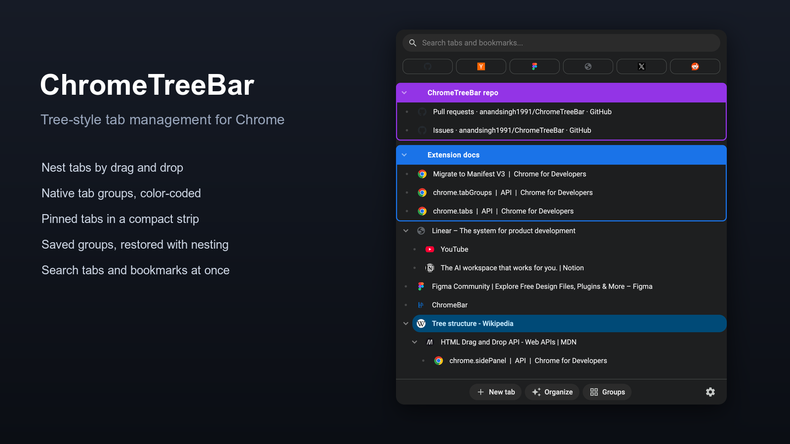
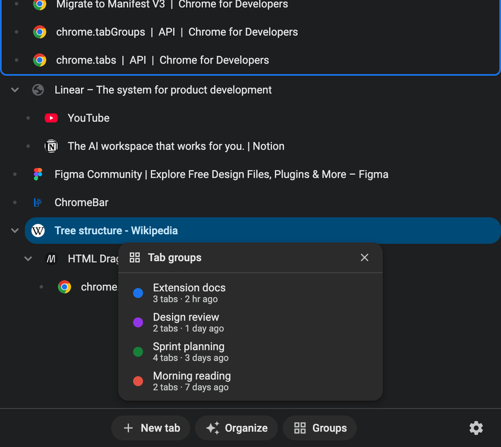
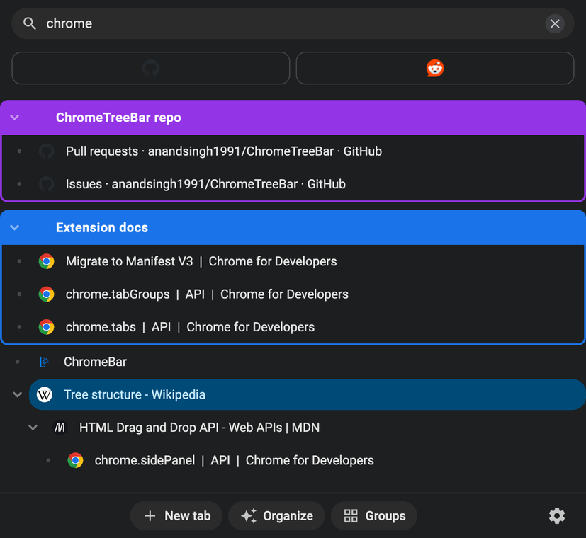

# ChromeTreeBar

**Manage your Chrome tabs in a tree structure with drag-and-drop support, automatic organization in groups, and superior search functionality**

## 🚀 Install

**[Install from Chrome Web Store →](https://chromewebstore.google.com/detail/chrometreebar/lagpggegakalnfipjmknjmachimpngfg)**

## ✨ Features

### 🌳 Tree Style Hierarchy
Say goodbye to the top tab bar overflowing. ChromeTreeBar displays all your open tabs in a clean, vertical list. You can nest tabs under other tabs by dragging and dropping them, creating a structured hierarchy that mirrors your workflow.

### 🎨 Native Chrome Tab Groups Integration
Do you use Chrome's native Tab Groups? ChromeTreeBar natively supports them! Your colored Tab Groups appear seamlessly in the tree. You can drag tabs in and out of groups, create new groups, or change group colors directly from the sidebar.

### 📌 Pinned Tabs Strip
Your pinned tabs stay at the top where you expect them, as compact pills under the search box instead of the wide tiles Chrome uses. The pills shrink as you pin more, so a full row of pinned tabs costs you a fraction of the vertical space. Pinning stays in sync with Chrome both ways.

Pinned tabs are never lost. Every window has your pins, closing one reopens it straight away, and each pin always comes back to the page you pinned it on, even after a Chrome restart. Unpin a tab to remove it for good. Prefer Chrome's ordinary pinning? Turn off **Keep pinned tabs** in the settings menu.

### 💾 Saved Groups
Close a tab group and ChromeTreeBar keeps it — name, color, tabs, and nesting. Open the Groups dialog to restore any of them with one click, right where you left off.

### 🪄 Auto-Organize
One click groups your loose tabs by website domain, merging into matching groups when they already exist. Your nested hierarchy survives the grouping.

### 🔖 Integrated Bookmarks
Your Chrome Bookmarks are available right alongside your active tabs. Access your saved pages quickly, search through them, and open them in new or current tabs with a simple right-click.

### 🔎 Instant Search
Looking for that one article you opened 2 hours ago? Use the built-in search bar to instantly filter your open tabs and bookmarks by title or URL. Pinned tabs are filtered too.

### 🖱️ Advanced Context Menu
Right-click any tab or group to unlock powerful actions:
- Duplicate a tab as a nested child of the original
- Pin or unpin a tab
- Mute/unmute tabs playing audio
- Close a tab along with all its nested children simultaneously
- Close every *other* tab, keeping the one you clicked and its children
- Add multiple selected tabs to a new color-coded group
- Open entire folders of bookmarks at once

### ⚡ Multi-Select Support
Hold `Ctrl`/`Cmd` or `Shift` to select multiple tabs at once. You can drag and drop entire branches of tabs, or close them all with a single click.

### 🎨 Theme Customization
Choose between Light, Dark, or Auto theme to match your workflow. Access the settings menu via the gear icon to select your preferred theme. Your choice is saved and persists across sessions.

### 🔊 Audio Indicators
Tabs playing audio show a speaker icon in the row, so you can find whatever is making noise without hunting. Mute or unmute straight from the right-click menu.

## 🆕 What's New in v1.4.0

- **Pinned tabs are never lost** — every window now has your pinned tabs, closing one reopens it straight away, and each pin comes back to the page you pinned it on, even after a Chrome restart. Unpin a tab to remove it for good
- **Reset to pinned page** — right-click a pinned tab to send it back to the page you pinned it on
- **Keep pinned tabs setting** — on by default; turn it off in the settings menu to go back to Chrome's ordinary pinning. When you first update, the pinned tabs from all your windows are shared across every window
- Fixes: switching to a pinned tab could leave the previous tab highlighted and unclickable, the group name box dropped the first few keystrokes, and Esc didn't clear the search box

## 🔒 Privacy First

Your browsing data belongs to you. ChromeTreeBar operates **entirely locally** within your browser:
- ✅ No accounts required
- ✅ No data is uploaded to external servers
- ✅ No analytics tracking

All your customized tree structures and group settings are saved securely using Chrome's local storage API directly on your device.

## 🎯 Quick Start

1. **Install** the extension from the [Chrome Web Store](https://chromewebstore.google.com/detail/chrometreebar/lagpggegakalnfipjmknjmachimpngfg)
2. **Click** the extension icon in your toolbar (or press `Alt+C`)
3. **Organize** your tabs by dragging and dropping them into a tree structure
4. **Search** through your tabs and bookmarks using the search bar
5. **Create groups** by selecting multiple tabs and right-clicking

## ⌨️ Keyboard Shortcuts

- `Alt+C` (Windows/Linux) or `Option+C` (Mac) - Toggle side panel
- `Ctrl/Cmd + Click` - Multi-select tabs
- `Shift + Click` - Range select tabs
- `Esc` - Clear search

## 🛠️ Permissions

ChromeTreeBar requires the following permissions:
- **tabs** - Read and manage your open tabs
- **tabGroups** - Access and modify Chrome Tab Groups
- **bookmarks** - Display your bookmarks in the side panel
- **sidePanel** - Render the extension's UI
- **storage** - Save your tree hierarchy locally
- **favicon** - Display website icons

[Read our Privacy Policy](PRIVACY_POLICY.md)

## 🤝 Contributing

Contributions are welcome! Feel free to:
- Report bugs by opening an issue
- Suggest new features
- Submit pull requests

## 📄 License

MIT License

## 🔗 Links

- [Chrome Web Store](https://chromewebstore.google.com/detail/chrometreebar/lagpggegakalnfipjmknjmachimpngfg)
- [Privacy Policy](PRIVACY_POLICY.md)
- [GitHub Repository](https://github.com/anandsingh1991/ChromeTreeBar)

---

Made with ❤️ for better tab management
